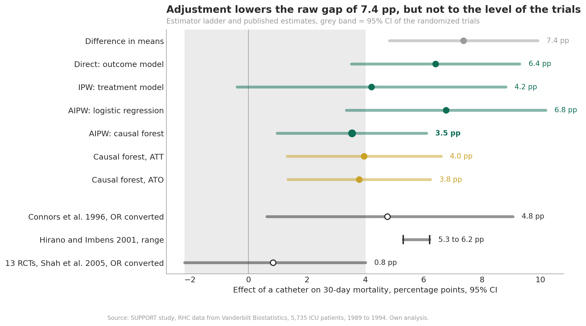
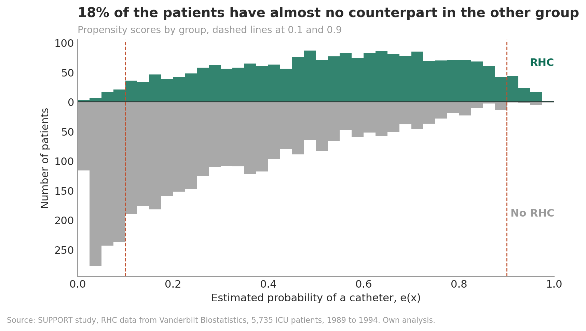
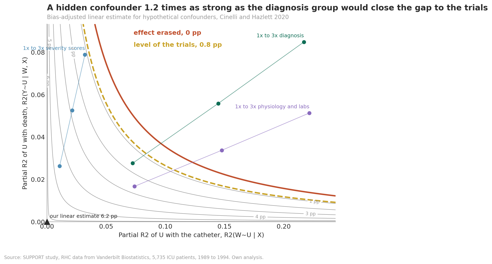
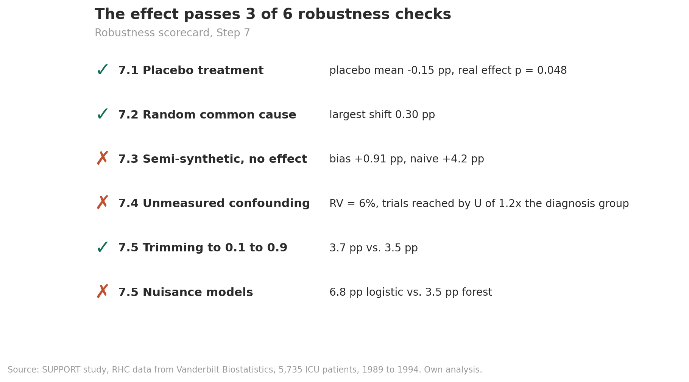

# Causal Inference: Right Heart Catheterization and Mortality

Does a right heart catheter on the first day of intensive care raise 30-day mortality? This project estimates the effect with causal machine learning on the SUPPORT data that Connors et al. analyzed in 1996, and asks how much unmeasured confounding it would take to explain why randomized trials later found no clear effect.

`Python` `Causal Inference` `Causal Forest` `EconML` `AIPW` `Overlap Weights` `Sensitivity Analysis`

> **After adjustment, a catheter on day 1 goes with 3.5 percentage points higher 30-day mortality, 95% CI 1.0 to 6.1, about half the raw difference of 7.4 pp.** The size depends on the model: the doubly robust estimate with logistic models gives 6.8 pp, 95% CI 3.3 to 10.2. In a linear model, which estimates 6.2 pp, a hidden confounder 1.2 times as strong as all recorded diagnosis variables would close the gap to the randomized trials, which found no clear effect on mortality.

---

## Background

Connors et al. found higher 30-day mortality among patients who received a catheter. An editorial by Dalen and Bone called for a moratorium, and catheter use in the US fell by about two thirds between 1993 and 2004. Randomized trials, pooled in a meta-analysis in 2005, found no clear effect on mortality. Was the observational result real harm, or confounding by severity of illness?

| Study | Design | Effect on mortality |
|---|---|---|
| Connors et al. 1996 | Observational, 5,735 patients | OR 1.24, 95% CI 1.03 to 1.49 |
| Shah et al. 2005 | Meta-analysis of 13 RCTs, 5,051 patients | OR 1.04, 95% CI 0.90 to 1.20 |

## Results

| Result | Value |
|---|---|
| Average treatment effect, causal forest, doubly robust | **3.5 pp**, 95% CI 1.0 to 6.1 |
| Effect among patients with a catheter, ATT | 4.0 pp, 95% CI 1.3 to 6.6 |
| Effect in the overlap population, ATO | 3.8 pp, 95% CI 1.3 to 6.2 |
| Randomized trials, converted | 0.8 pp, 95% CI −2.2 to 4.0 |
| Robustness checks passed | **3 of 6** |
| Effect heterogeneity | Not detectable, calibration test β = 0.24, one-sided p = 0.39 |

Estimator ladder and published estimates:

| Estimator | Estimate, pp | SE | 95% CI |
|---|---|---|---|
| Difference in means | 7.4 | 1.3 | 4.8 to 9.9 |
| Direct: outcome model | 6.4 | 1.5 | 3.5 to 9.3 |
| IPW: treatment model | 4.2 | 2.3 | −0.4 to 8.8 |
| AIPW: logistic regression | 6.8 | 1.7 | 3.3 to 10.2 |
| **AIPW: causal forest** | **3.5** | **1.3** | **1.0 to 6.1** |
| Connors et al. 1996, OR converted | 4.8 | | 0.6 to 9.1 |
| Hirano and Imbens 2001, one propensity model | 5.3 to 6.2 | | |
| 13 RCTs, Shah et al. 2005, OR converted | 0.8 | | −2.2 to 4.0 |

*Risk differences in 30-day mortality, percentage points. Published odds ratios were converted at the mortality without a catheter in the data, 30.6%.*

## Approach

The notebook follows an eight-step causal ML pipeline.

| Step | What was done |
|---|---|
| **1. Research question** | Effect of a catheter on day 1 on 30-day mortality as a risk difference. 5,735 patients, 2,184 with a catheter, no missing outcomes. Secondary disease category kept with its own category for missing. Activities of daily living, urine output and the Duke Activity Status Index dropped, the last one because its filled-in values reveal who was well enough for a day-3 interview |
| **2. Causal structure** | 50 day-1 covariates in six groups, each related to both the catheter and death. Admission period checked, not a confounder. DAG with unmeasured bedside severity, backdoor criterion checked with networkx |
| **3. Estimand** | ATE primary, ATT for the comparison with Connors et al., overlap population for the comparison with the trials, CATE secondary. Target population: patients alive and in hospital two days after study entry |
| **4. Assumptions** | SUTVA argued. 18% of patients outside propensity 0.1 to 0.9, largest IP weight 94. Overlap weights balance all 70 columns: largest ASMD 0.35 before, 0.013 after |
| **5. Estimation** | Regression forests for the nuisances, causal forest with econml.grf, 2,000 trees, leaf size by R-loss. Doubly robust ATE, ATT and ATO, estimator ladder, comparison with three published estimates |
| **6. Evaluation** | Calibration test, predicted against estimated effects by quartile, RATE with split and score. None of them confirms heterogeneity |
| **7. Robustness** | Placebo treatment, random common cause, semi-synthetic outcome with known effect, sensitivity to unmeasured confounding by Cinelli and Hazlett on a linear model, benchmarked against confounder groups, trimming and choice of nuisance models |
| **8. Interpretation** | Best linear projection, partial dependence and three patient profiles, all exploratory. Summary and limitations |

## Key Findings

**The raw comparison mixes the catheter with severity.** Patients with a catheter died more often, 38.0% against 30.6%, but they were sicker: higher APACHE scores, lower blood pressure, worse oxygenation and more often sepsis with multi-organ failure. After adjusting for 50 day-1 covariates, the causal forest estimates 3.5 pp.

**The size depends on the model.** All adjusted point estimates lie above zero, but they range from 3.5 to 6.8 pp, and the IPW interval includes zero. The two doubly robust estimators differ by 3.2 pp although their nuisance models fit about equally well. IPW is unstable, because one patient gets a weight of 94.

**Patients without a counterpart do not drive the result.** 18% of the patients have a propensity outside 0.1 to 0.9. The effect in the overlap population is 3.8 pp, after trimming 3.7 pp.

**A hidden confounder somewhat stronger than all diagnosis variables could explain the gap to the trials.** The linear estimate of 6.2 pp drops to the trials' 0.8 pp if an unmeasured confounder explains 5.3% of the remaining variance of both the catheter decision and death. A confounder 1.2 times as strong as all twelve diagnosis variables together would do the same. The smaller forest estimate would need a weaker one. Severity that physicians saw at the bedside is a plausible candidate.

**There is no detectable difference between patients.** Calibration test, quartile check and RATE are all null. The semi-synthetic test shows the limits: with a slope of 2 pp per 10 APACHE points built in, the calibration test detects it in only 5 of 20 runs and the best linear projection in 8 of 20. A larger effect in sicker patients is suggestive, not confirmed.

## Visualizations

Estimator ladder and published estimates. Every adjustment lowers the raw difference, but only the causal forest estimates lie inside the confidence interval of the trials, the gray band.



Overlap. Many patients without a catheter had almost no chance of getting one, which makes inverse probability weights explode.



Sensitivity to unmeasured confounding. A hidden confounder somewhat stronger than all diagnosis variables together would move the linear estimate of 6.2 pp to the level of the trials.



Robustness scorecard. The pipeline passes the placebo, noise and trimming checks. In simulated data without an effect a bias of 0.9 pp remains, so the main estimate may be somewhat too high. The size of the effect depends on the nuisance models, and the gap to the trials is sensitive to hidden confounding.



All 17 figures are in [`figures/`](figures), the key numbers as JSON and CSV in [`results/`](results).

## Data

The RHC data from the SUPPORT study are published by [Vanderbilt Biostatistics](https://hbiostat.org/data/) for methods research on causal inference. The notebook downloads them on the first run and verifies a SHA-256 checksum. The data are not stored in this repository.

## Reproducibility

```bash
git clone https://github.com/JananthanU/causal-inference-heart-catheter-mortality
cd causal-inference-heart-catheter-mortality
pip install -r requirements.txt
jupyter notebook notebooks/rhc_causal_ml_pipeline.ipynb
```

Run **Kernel > Restart Kernel and Run All Cells**. A full run takes about 10 to 20 minutes depending on the number of CPU cores, most of it in the refits of Step 7. Tested with econml 0.17 and scikit-learn 1.9.

One seed, 42, controls all forests, splits, permutations and bootstraps. Forest-based values can move slightly on another platform. Figures are written to `figures/`, the key numbers and an executive summary to `results/`.

## Limitations

- Unconfoundedness cannot be tested. In the linear model of the sensitivity analysis, a hidden confounder 1.2 times as strong as all recorded diagnosis variables could explain the whole gap to the trials, and the smaller forest estimate would need a weaker one.
- SUPPORT excluded patients who died or left the hospital within 48 hours. The direction of the resulting bias is unknown.
- The size of the effect depends on the nuisance models: 3.5 pp with forest nuisance models, 6.8 pp with logistic ones.
- Covariates were recorded around the time of the decision. Values measured after the catheter was placed could already reflect it.
- The data describe catheter use in five US teaching hospitals between 1989 and 1994. The trials enrolled other patients, and practice has changed since.
- Published odds ratios were converted at the baseline risk of this data set, so the comparison is approximate.
- With a 0/1 outcome and 5,735 patients, the null result for heterogeneity means differences are not detectable, not that the effect is the same for everyone.

## References

- Connors AF, Speroff T, Dawson NV, et al. The effectiveness of right heart catheterization in the initial care of critically ill patients. JAMA 1996;276:889–897.
- Dalen JE, Bone RC. Is it time to pull the pulmonary artery catheter? JAMA 1996;276:916–918.
- Hirano K, Imbens GW. Estimation of causal effects using propensity score weighting: an application to data on right heart catheterization. Health Services and Outcomes Research Methodology 2001;2:259–278.
- Shah MR, Hasselblad V, Stevenson LW, et al. Impact of the pulmonary artery catheter in critically ill patients: meta-analysis of randomized clinical trials. JAMA 2005;294:1664–1670.
- Wiener RS, Welch HG. Trends in the use of the pulmonary artery catheter in the United States, 1993–2004. JAMA 2007;298:423–429.
- Athey S, Tibshirani J, Wager S. Generalized random forests. Annals of Statistics 2019;47:1148–1178.
- Nie X, Wager S. Quasi-oracle estimation of heterogeneous treatment effects. Biometrika 2021;108:299–319.
- Li F, Morgan KL, Zaslavsky AM. Balancing covariates via propensity score weighting. Journal of the American Statistical Association 2018;113:390–400.
- Crump RK, Hotz VJ, Imbens GW, Mitnik OA. Dealing with limited overlap in estimation of average treatment effects. Biometrika 2009;96:187–199.
- Cinelli C, Hazlett C. Making sense of sensitivity: extending omitted variable bias. Journal of the Royal Statistical Society Series B 2020;82:39–67.